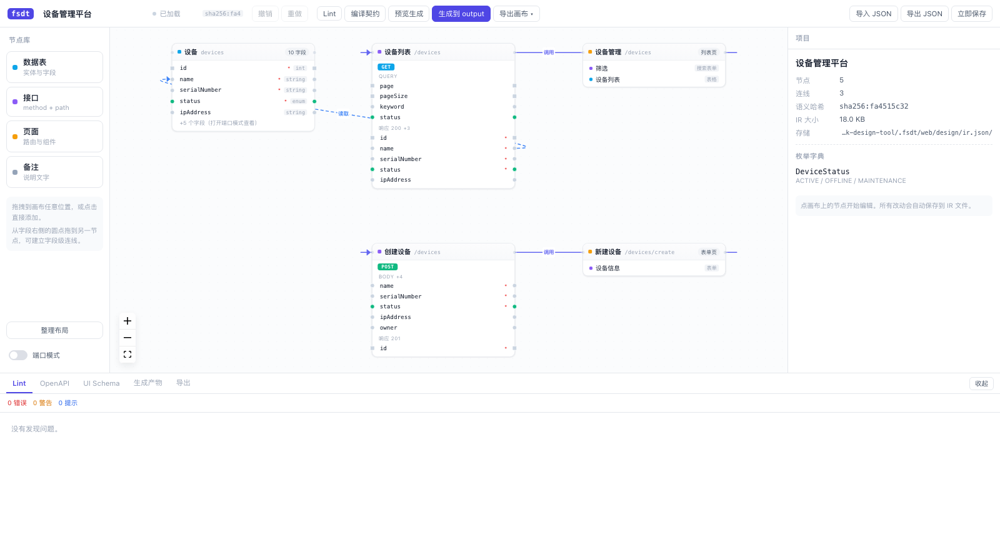

# 全栈全链路设计工具（fsdt）

从一个画布 IR 出发，编译出 **OpenAPI 契约 / UI Schema / 示例数据 / Vue 3 前端 / NestJS 后端**，
并能在 CI 里拦下「改了画布忘了重新生成」的漂移。

```
画布 IR（唯一真相源）
  ├─ compile → OpenAPI 3.1 / UI Schema / 示例数据 / Lint 报告
  ├─ gen     → Vue 3 + Element Plus 前端 / NestJS 12 + Prisma 后端
  ├─ export  → SVG / PNG / Mermaid / draw.io / JSON / Figma 脚本
  └─ lint    → L001–L014 契约规则（text / json / sarif）
```

## 为什么 IR 是唯一真相源

OpenAPI 没有页面布局词汇：它描述得了「`GET /devices` 返回什么」，描述不了
「设备列表页有个搜索框、表格、分页，点行跳详情页」。所以 OpenAPI 只能是**产物**，
不能是源头。真正的源头是画布 IR，其余一切都满足 `产物 = f(IR, Options)` 的纯函数关系
——这才让「同一 IR 两次生成字节一致」和「CI 漂移门禁」成立。

## 快速开始

```bash
pnpm install
pnpm build

cd /path/to/your-project
fsdt init --name 设备管理平台        # 创建 design/ir.json（文件模式）
fsdt compile --stdout json          # 看当前 IR 编译出的契约（不写盘）
fsdt lint                           # 跑契约规则
fsdt gen --out ./output             # 生成前后端（默认只预览）
fsdt gen --check                    # CI 门禁：产物与画布不一致则退出码 1
```

## 画布工作台（apps/web）

CLI 之外的可视化入口：拖节点建图、改字段、跑 Lint、编译契约、生成产物、导出画布。



```bash
pnpm install
pnpm build      # 首次需要：工作台直接消费各包的 dist
pnpm dev        # → http://localhost:5180
```

**和 CLI 共用同一份 IR**：

| 情况 | 工作台用哪个文件 |
|---|---|
| 仓库根有 `design/ir.json` | 直接用它（和 `fsdt init` 生成的位置一致） |
| 没有 | 用 `.fsdt/web/design/ir.json`，首次打开种一份「设备管理」示例 |
| 想指向别处 | `FSDT_WEB_WORKSPACE=/path/to/project pnpm dev` |

界面上每处改动 800ms 防抖自动落盘，所以改完直接 `fsdt lint` / `fsdt gen` 就能看到结果，不需要导出导入。

数据通道是 vite 的 dev 中间件（`apps/web/server/`），不是一个独立后端进程——少一个进程就少一份「谁先写的」竞态，而且各端点直接调 `@fsdt/*` 的库函数，产物与命令行逐字节一致。

| 端点 | 作用 |
|---|---|
| `GET /api/state` | 读 IR + 工作区路径 + 语义哈希 |
| `PUT /api/ir` | 校验后原子写盘（校验不过拒绝写入） |
| `POST /api/lint` | L001–L014 |
| `POST /api/compile` | OpenAPI 3.1 + UI Schema |
| `POST /api/gen` | 渲染 Vue / NestJS，`write: true` 才落盘 |
| `POST /api/export` | svg / png / mermaid / drawio / json |

界面能力：四类节点（表 / 接口 / 页面 / 备注）、五类边（call / read / write / map / navigate，按两端类型自动判定）、字段级端口、表字段编辑器（含约束 / 枚举 / 外键）、接口与页面检查器、撤销重做（60 步）、自动保存、「整理布局」、Lint 面板点条目定位节点、生成产物预览。

**还没做的**（对应技术设计里未落地的部分）：`tabs` / `card` 容器组件、候选确认面板（Figma / 图片导入）、快照与回滚、服务模式（多项目 / HTTP API）、AI 填充。

## 命令

| 命令 | 作用 | 是否写盘 |
|---|---|---|
| `init` | 创建 `design/ir.json` | 是（不覆盖已有文件） |
| `compile` | IR → OpenAPI / UI Schema / 示例数据 | 仅 `--out` |
| `lint` | 契约规则检查 | 否 |
| `gen` | IR → 前后端代码 | 仅 `--out` |
| `sample` | 示例数据（确定性） | 仅 `--out` |
| `export` | 画布导出为图 | 仅 `--out` |
| `diff` | IR 语义 diff（坐标变化不算变化） | 否 |
| `import` | 设计图 → 字段候选（需人工确认） | 仅 `apply` |

退出码：`0` 成功 / `1` 校验失败或存在差异 / `2` 用法错误。

## CLI 的三条纪律

1. **默认只读**：`gen`、`compile`、`export` 没有 `--out` 时只输出到 stdout，绝不写盘。
2. **进 CI 的命令必须确定性**：同 IR + 同 seed 两次生成字节级一致。
3. **`--check` 与 `--out` 互斥**：`--check` 是门禁，顺手把差异写掉会让 CI 永远绿。

## 包结构

```
apps/cli                      命令行
apps/web                      画布工作台（Vue 3 + Vue Flow + Element Plus）
packages/core-ir              IR 类型 / Zod schema / 校验 / 语义哈希 / 迁移
packages/compiler             IR → OpenAPI 3.1 + UI Schema
packages/sample               确定性示例数据（内置 PRNG，不用 faker）
packages/lint                 L001–L014 规则 + SARIF
packages/exporter             SVG / PNG / Mermaid / draw.io / JSON / Figma
packages/importer             Figma / 视觉模型 → 字段候选
packages/generators/runtime   Writer / 区块标记 / manifest
packages/generators/vue       Vue 3 + Element Plus
packages/generators/nestjs    NestJS 12 + Prisma
```

依赖方向严格单向：`core-ir ← 其余所有包`，生成器之间互不 import。

## 关键设计取舍

- **手写 interface + 手写 Zod schema**，不由 zod 反推类型：schema 要比接口更宽容（旧 IR 走默认值），
  反推会把类型全变可选，污染所有下游。漂移由 `schema-type-parity.test.ts` 的「静默丢键」检测兜住。
- **不用模板引擎**（Eta/Handlebars），用 `Writer` 手写：模板引擎的空白处理跨版本会变，
  一变所有黄金样例全红且原因不可见；Vue/NestJS 产物的三层嵌套缩进也要能算。
- **不用 faker 造数**：它的输出跨版本会变，升级后黄金样例全挂。内置 mulberry32 + 中文词表。
- **图片通道不内置模型 provider**：`createVisionExtractor` 通过注入 `callModel` 解耦，
  CLI 用 OpenAI 兼容协议适配（`FSDT_VISION_API_KEY` / `FSDT_VISION_BASE_URL` / `FSDT_VISION_MODEL`）。
- **字段改名不转拼音**：中文名保留为 `label`，`name` 由用户确认时补；兜底 `field1` 并告警。
- **导入只产生候选**，不直接写 IR：自动写入的错误字段会被 OpenAPI → DTO → 前后端一路放大。

## 开发

```bash
pnpm verify            # 一条命令跑完下面全部
pnpm build             # 全包 tsc -b（含 apps/web 的 vue-tsc + vite build）
pnpm typecheck         # tsc -b + 逐包 typecheck
pnpm typecheck:tests   # 逐包检查测试文件类型
pnpm test              # 669 条单测
pnpm smoke             # 端到端：真跑一遍全部 CLI 命令
pnpm dev               # 画布工作台（http://localhost:5180）
```

`pnpm smoke` 值得单独说：单测覆盖的是各包行为，而「CLI 装起来能不能跑通一条链路」
是另一回事——路径解析、退出码、`--check` 与 `--out` 互斥，只有真跑一次才看得见。
它在临时目录里 init → lint → compile → gen → 手改后验漂移 → 恢复 → 验幂等 → sample → export，
任何一步不符合预期就非零退出。

## 生成物是能真编译的

`packages/generators/nestjs/test/compile.test.ts` 会真的用 tsc 编译生成的后端工程；
前端侧则由 `vue-generator.test.ts` 里的「可编译性」用例守住几个坑：

- 接口字段不能写成 `unknown`（否则 `v-model` 全报 TS2322）
- 枚举必须带出类型定义（否则下拉框失去类型约束）
- store 的 `query` 要用类型别名，不能用 `Record<string, unknown>`
- 必须有 `src/env.d.ts`（否则 `import.meta.env` 报 TS2339）
- `package.json` 的 `name` 必须是合法 npm 包名（中文项目名会让 `pnpm install` 失败）
- Prisma 7 的 `url` 在 `prisma.config.ts`，不在 `schema.prisma`

## 文档

- [`docs/.../PRD-全栈全链路设计工具-1019.md`](docs/全栈全链路设置工具-1019/PRD-全栈全链路设计工具-1019.md)
- [`docs/.../TECH-DESIGN-全栈全链路设计工具-1019.md`](docs/全栈全链路设置工具-1019/TECH-DESIGN-全栈全链路设计工具-1019.md)
- [`docs/.../BRD-全栈全链路设置工具-1019.md`](docs/全栈全链路设置工具-1019/BRD-全栈全链路设置工具-1019.md)
